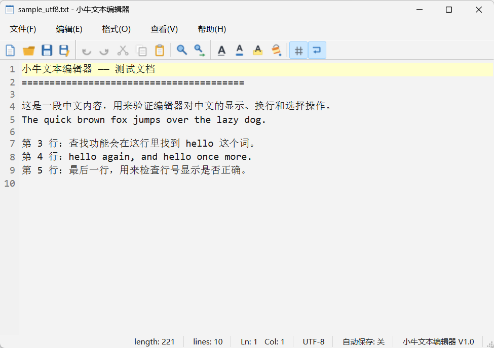

# 实验 2：简单文本编辑器（小牛文本编辑器）

《Qt 应用程序开发》实验二——用 Qt 6 Widgets 实现一个多窗口文本编辑器。
界面在 Qt Designer 里搭建，菜单栏和三条工具栏全部由 QAction 生成；
编辑区是从 `QPlainTextEdit` 派生的 `CodeEditor`（带行号、当前行高亮）；
文件读写自己处理编码识别和原子写入，查找 / 替换 / 自动保存 / 状态栏信息也都已跑通。



## 功能

- 新建 / 打开 / 保存 / 另存为，未命名文档保存时自动转为“另存为”
- 文本编码识别：UTF-8、UTF-8 BOM、UTF-16 LE/BE、GBK；保存时按原编码写回
- 二进制文件（含 NUL 字节）拒绝打开；超过 32 MB 的文件不载入
- `QSaveFile` 原子写入：保存失败不会破坏原文件，修改标记保持不变
- 撤销 / 重做（Ctrl+Y 与 Ctrl+Shift+Z 都支持）、剪切 / 复制 / 粘贴 / 全选
- 查找 / 替换：区分大小写、向上 / 向下、循环查找、全部替换一次撤销
- 字体、字体颜色、字体背景色、编辑器背景色
- 自动换行、显示 / 隐藏行号（Ctrl+L）
- 标题栏按修改状态显示 `*`，状态栏实时显示长度、行数、行列号、编码、自动保存状态
- 查看菜单可整体显示 / 隐藏工具栏与状态栏
- 定时自动保存（60 秒，勾选“文件 → 自动保存”）
- “关于”对话框显示程序信息、开发者、学号、邮箱

## 目录结构

```
.
├── texteditor.pro          # qmake 工程文件
├── main.cpp                # 入口（支持命令行传入文件路径）
├── mainwindow.h/.cpp/.ui   # 主窗口：菜单 / 工具栏接线、文件操作、查找替换
├── codeeditor.h/.cpp       # 带行号区的编辑器（QPlainTextEdit 派生）
├── finddialog.h/.cpp       # 查找 / 替换共用的对话框
├── aboutdialog.h/.cpp      # “关于”对话框
├── fileio.h/.cpp           # 编码识别、原子读写
├── dialoghelpers.h/.cpp    # 中文按钮的“是否保存”询问框
├── appinfo.h               # 程序名、版本、开发者信息
├── resources.qrc           # 工具栏图标
├── icons/                  # 由 tools/make_icons.py 生成的 PNG
├── samples/                # 示例文本（UTF-8 / GBK / 只读 / 二进制）
├── tools/
│   ├── make_icons.py       # 生成图标
│   ├── make_samples.py     # 生成示例文本
│   └── shots/              # 截图工具（报告用）
├── tests/                  # QtTest 自动化测试
├── docs/
│   ├── dev-log.md          # 开发与缺陷记录
│   ├── report/             # 实验报告
│   └── screenshots/        # 运行截图（25 张）
├── build.bat / run.bat     # 一键编译 / 运行
└── README.md
```

## 设计要点

### 1. 界面：Designer + Action 驱动

中央区域是一个 `QVBoxLayout`（四边 margin 与 spacing 全为 0），里面放由
`QPlainTextEdit` 提升而来的 `CodeEditor`，编辑区紧贴窗口边缘。
菜单和工具栏不写界面代码：`.ui` 里只定义 QAction（文字、图标、快捷键、
状态栏提示），菜单和三条工具栏分别引用这些 Action，共 17 个工具按钮：

| 工具栏 | 按钮 |
| --- | --- |
| 文件 | 新建、打开、保存、另存为 |
| 编辑 | 撤销、重做、剪切、复制、粘贴 ┊ 查找、替换 |
| 格式 | 字体、字体颜色、字体背景色、编辑器背景色 ┊ 行号、自动换行 |

### 2. 编辑器：行号区与当前行高亮

`CodeEditor` 内部放一个 `LineNumberArea` 子控件，用 `setViewportMargins()`
把文字区往右挤出一条边距；行号宽度按总行数位数计算，`blockCountChanged`
时重算，`updateRequest` 时滚动或重绘。当前行用 `ExtraSelection` 画整行底色，
有选区时不画高亮，避免盖住选中的文字。

### 3. 编码识别与原子保存

`FileIo` 把“字节 → QString”和“QString → 字节”分开处理：

```
BOM(UTF-8/UTF-16) → 严格 UTF-8 → GBK（代码页 936）→ 都失败则报错
```

没有 BOM 时先查 NUL 字节（UTF-16 已在 BOM 分支排除），含 NUL 视为二进制文件。
保存用 `QSaveFile`：先写临时文件，`commit()` 时原子替换，失败则原文件不变；
GBK 保存前先确认每个字符都能被该编码表示，不能表示时提示改用 UTF-8。

### 4. 查找 / 替换

`FindDialog` 查找与替换共用，只差一行“替换为”，通过信号把用户的选择发给主窗口。
查找从光标位置开始，到末尾后回到开头再找一次并提示；两端都没有才弹“未找到”。
`replaceAll()` 用 `beginEditBlock/endEditBlock` 把多次替换合成一次撤销，
替换后从插入文本之后继续找，避免“替换文本包含查找词”时死循环。

### 5. Action 使能状态

剪切 / 复制看选区，粘贴看剪贴板，撤销 / 重做看撤销栈。
`copyAvailable`、`undoAvailable`、`redoAvailable`、`cursorPositionChanged`、
`textChanged` 与剪贴板的 `dataChanged` 共六个信号都接到 `updateEditActions()`，
保证任何一处状态变化后按钮状态都一致。

### 6. 标题与状态栏

标题格式为 `* 文件名 - 小牛文本编辑器`（有修改时带 `*`）。
状态栏右侧 6 个常驻标签显示 length / lines / Ln:Col / 编码 / 自动保存开关 / 程序名，
左侧消息区显示操作提示，两者互不覆盖。

## 快捷键

| 功能 | 键位 | 功能 | 键位 |
| --- | --- | --- | --- |
| 新建 | `Ctrl+N` | 打开 | `Ctrl+O` |
| 保存 | `Ctrl+S` | 另存为 | `Ctrl+Shift+S` |
| 撤销 | `Ctrl+Z` | 重做 | `Ctrl+Y` / `Ctrl+Shift+Z` |
| 剪切 / 复制 / 粘贴 | `Ctrl+X` / `Ctrl+C` / `Ctrl+V` | 全选 | `Ctrl+A` |
| 查找 | `Ctrl+F` | 替换 | `Ctrl+H` |
| 显示行号 | `Ctrl+L` | 自动换行 | `Ctrl+Shift+W` |
| 退出 | `Ctrl+Q` | | |

## 编译与运行

开发环境：Qt 6.7.2 (MinGW 64bit) / GCC 13.1.0 / qmake + mingw32-make / Windows 11。

仓库带了两个批处理脚本（Qt 安装位置不同时改脚本里的 `QTDIR` / `MINGWDIR`）：

```bat
build.bat    :: qmake + mingw32-make
run.bat      :: 运行 build\release\TextEditor.exe
```

手动编译：

```bash
mkdir build && cd build
qmake ../texteditor.pro
mingw32-make -j8
./release/TextEditor.exe
```

## 测试

```bash
cd tests && mkdir build && cd build
qmake ../tests.pro
mingw32-make -j8
./release/tst_editor.exe -platform offscreen
```

20 个用例覆盖：UTF-8 / BOM / GBK 识别、二进制拒绝、GBK 与 UTF-8 往返、
只读文件写入失败且原内容不变、标题与编码、行号宽度、循环查找、区分大小写、
全部替换一次撤销、替换跟随选区、保存清除修改标记、Action 使能、打开异常文件不破坏内容。

```
Totals: 20 passed, 0 failed, 0 skipped
```

## 截图

25 张运行截图在 `docs/screenshots/`，由 `tools/shots` 驱动真实程序截取：

```bash
cd tools/shots && mkdir build && cd build
qmake ../shots.pro
mingw32-make -j8
./release/shots.exe ..\..\.. ..\..\docs\screenshots
```

## 实验报告

报告正文与全部 25 张运行截图见
[docs/report/实验2-简单文本编辑器_实验报告.docx](docs/report/实验2-简单文本编辑器_实验报告.docx)，
正文宋体四号、标题宋体二号；“边界与异常场景”一节记录了未保存关闭、文件不存在、
二进制文件、GBK 编码、只读文件保存失败五个场景的输入、现象、原因与修改结果。

## 开发记录

编译错误、边界缺陷与修复过程见 [docs/dev-log.md](docs/dev-log.md)。

## 注意事项

1. **构建目录不要放在含中文的路径下**。MinGW 的 `windres`、Qt 的 `moc`
   在中文路径下容易报 `Failed to resolve include` 之类的警告；脚本里调用
   qmake 一律使用相对路径。
2. **源码目录不要保留旧的 `ui_mainwindow.h`**，它是 uic 的生成产物，
   残留在源码目录会遮蔽构建目录里的新文件（已在 `.gitignore` 中忽略）。
3. 在 Qt Creator 里直接打开 `texteditor.pro` 即可，测试工程是 `tests/tests.pro`，
   截图工程是 `tools/shots/shots.pro`。

## 关于

- 姓名：张梓鸿
- 学号：2024414300227
- 班级：24软卓2班
